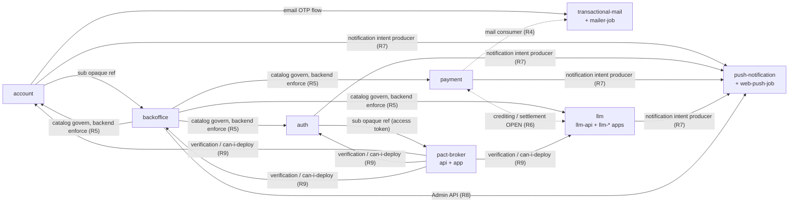

# 07 — Domains

> **Phạm vi:** ngôn ngữ domain dùng chung của Ecoma, catalog các bounded context, context map theo kiến trúc đích, và các ranh giới còn chưa chốt. Đây là **tài liệu canonical** cho ba thứ đó; mọi tài liệu khác chỉ tham chiếu, không sao chép.
>
> 07 **không** chứa topology/hostname/routing → [`01-architecture.md`](./01-architecture.md) · database/binding → [`01`](./01-architecture.md) §4 · Nx project graph/tag/DDD layer → [`05-code-architecture.md`](./05-code-architecture.md) · API/event schema/protocol → machine-readable contract · deployment/CI/CD/runbook/platform fact → [`02`](./02-delivery.md)/[`03`](./03-operations.md)/[`04`](./04-platform-facts.md) · trạng thái triển khai → không ghi ở đây.
>
> **Quy tắc đọc:** tài liệu này mô tả **kiến trúc đích**, không phải hiện trạng. Một bounded context không bị loại khỏi catalog vì thiếu runtime, database, hay provisioning — `payment` và `llm` là ví dụ. "Chưa triển khai" không đồng nghĩa "chưa chốt": chỉ những quyết định **thật sự chưa có đáp án** mới vào §5.

---

## 1. Mục đích và cách đọc

07 trả lời bốn câu hỏi:

1. **Ngôn ngữ domain dùng chung là gì?** (§2) — các thuật ngữ xuyên hệ thống, mỗi thuật ngữ mang nghĩa gì trong Ecoma, context nào sở hữu nó, và nó khác các thuật ngữ hay bị nhầm.
2. **Bounded context nào tồn tại, trách nhiệm và ranh giới ra sao?** (§3) — catalog.
3. **Các context tương tác với nhau như thế nào trong kiến trúc đích?** (§4) — context map.
4. **Còn ranh giới nào thật sự chưa chốt?** (§5) — chỉ những mục đó, không phải "chưa implement".

### 1.1 Bốn trục không được nhầm lẫn

| Trục                   | Nghĩa                                                                     | Ví dụ                                                                        | Nơi canonical                          |
| ---------------------- | ------------------------------------------------------------------------- | ---------------------------------------------------------------------------- | -------------------------------------- |
| **Bounded context**    | Ranh giới nghiệp vụ — ai sở hữu trách nhiệm và dữ liệu của một capability | `pact-broker`                                                                | **07 (đây)**                           |
| **Deploy unit**        | Một Worker/runtime unit chạy request                                      | `account`, `auth`                                                            | [`01`](./01-architecture.md) §2        |
| **Nx scope**           | Trục sở hữu code (`scope:*`)                                              | `scope:messaging` bao trùm control + delivery plane của `transactional-mail` | [`05`](./05-code-architecture.md) §6.3 |
| **Deployment project** | Project Pulumi provision hạ tầng                                          | `deploys/account-deploy`                                                     | [`05`](./05-code-architecture.md) §2.1 |

Một bounded context có thể có **nhiều** deploy unit (A10) — đó là chủ đích, không phải bất thường. Một scope có thể bao trùm nhiều deploy unit cùng context. Deployment project sở hữu **hạ tầng**, không sở hữu bounded context. Nhầm bốn trục này thành một là nguồn gốc của mọi nhầm lẫn trong navigation và ownership. `account` và `auth` là hai bounded context riêng — tách deploy unit của chúng không phải ví dụ cho trục này; ví dụ đúng là `pact-broker` (một context, hai deploy unit) và `transactional-mail` (control plane + delivery plane).

### 1.2 Quy tắc về hiện trạng

- **Không** có cột/ký hiệu "đã implement / chưa implement / chưa provision / chưa deploy" trong catalog hay context map. Trạng thái triển khai là thuộc tính của implementation, không phải của domain map.
- "Chưa triển khai nhưng đã kiến trúc hoá" (ví dụ `payment`) **vẫn nằm trong catalog** với đầy đủ trách nhiệm và ranh giới — vì tài liệu kiến trúc đã định nghĩa nó.
- "Chưa chốt quyết định" (ví dụ hợp đồng crediting giữa `payment` và `llm`) **không** phải "chưa triển khai" — nó vào §5, không vào catalog.

---

## 2. Ngôn ngữ domain dùng chung

Mỗi thuật ngữ dưới đây được định nghĩa theo **nghĩa Ecoma**, không theo nghĩa chung của industry. Glossary này **không** ép các bounded context dùng chung một từ vựng: mỗi context giữ autonomy trong naming nội bộ; đây chỉ là bản đồ để các context nói chuyện được với nhau.

### 2.1 Account / Account ID / `sub`

- **Account** — bằng chứng đăng nhập của một người dùng; là trách nhiệm nghiệp vụ của bounded context `account`. Gồm credential, MFA/passkey, browser session, profile, preference, privacy/legal consent. Không phải "user nghiệp vụ" của bất kỳ application nào.
- **Account ID (`sub`)** — opaque identifier của account, không tái sử dụng, không tái phát hành. Là **tham chiếu** mà các context khác (vd. `backoffice` staff member, `pact-broker` tenant membership) dùng để liên kết; **không** phải foreign key xuyên database, và **không** phải quan hệ sở hữu (A21).
- **Khác biệt:** `sub` ≠ email (email là contact credential + login identifier, không phải OIDC `sub`); `sub` ≠ staff member (staff là khái niệm của `backoffice`, liên kết bằng `sub`).

### 2.2 Authentication / Authorization

- **Authentication** — chứng minh người dùng đã xác thực. Nguồn sự thật: `account` (`db-account`). `auth` **không** tự trả lời được câu hỏi này; nó nhận kết quả qua contract đã xác thực.
- **Authorization** — quyết định người dùng được làm gì trên tài nguyên của một application. Nguồn sự thật: application sở hữu tài nguyên đó, với permission catalog do `backoffice` định nghĩa. Token hợp lệ **không** tự động hàm ý quyền (A22, invariant 32).

### 2.3 Staff / Role / Permission / OAuth scope

- **Staff** — người dùng được gán vai trò trong `backoffice`; liên kết account bằng `sub`. Trạng thái staff **không** phải trạng thái account (invariant 31).
- **Role** — tập permission gán cho staff trong `backoffice` (role built-in + custom role — custom role v1 **tắt** theo ADR-0004).
- **Permission** — capability theo hình `domain.action`, catalog do `backoffice` sở hữu; backend sở hữu tài nguyên tự enforce trên mọi protected request (A23).
- **OAuth scope** — quyền truy cập protocol mà client yêu cầu trong luồng OAuth 2.0/OIDC. **Không** phải application-level permission, không mang trạng thái staff, không đủ granularity cho object-level check. `auth` không nhúng role/permission nghiệp vụ vào token (A22).

### 2.4 Tenant / Membership / Workspace

- **Tenant** — ranh giới cách ly dữ liệu của một tổ chức/customer. Trong Ecoma, `pact-broker` sở hữu tenant/membership/role **của chính broker**; các context khác (vd. `llm`) có khái niệm workspace/seller riêng và không dùng chung tenant của broker.
- **Membership** — quan hệ giữa một account (`sub`) và một tenant, kèm role trong tenant đó.
- **Workspace** — không gian làm việc trong `llm` (seller/workspace, offer, catalog, thống kê). Khác tenant của broker; không đồng nhất hai khái niệm.

### 2.5 Payment / Credit / Ledger / Transaction / Payout

- **Payment** — bounded context sở hữu ledger credit, payment transaction và seller payout. Chưa có deploy unit; vẫn là bounded context vì tài liệu kiến trúc đã định nghĩa trách nhiệm và data ownership.
- **Credit** — đơn vị giá trị lưu trong ledger của `payment` (`db-payment`, `01` §4). Quan hệ giữa credit của `payment` và quota của `llm` là **chưa chốt** — không giả định hai bên dùng chung một nguồn sự thật; xem §5.1.
- **Ledger** — sổ cái credit do `payment` sở hữu (`db-payment`).
- **Payment transaction** — giao dịch thanh toán do `payment` sở hữu.
- **Payout** — chi trả cho seller do `payment` sở hữu.

### 2.6 Quota / Usage / Reservation / Settlement

- **Quota** — giới hạn tài nguyên (token/request) mà `llm-api` cấp cho một consumer/key; authority nằm ở PostgreSQL (`db-llm-gateway`) (A7, invariant 16).
- **Usage** — lượng tài nguyên đã thực sự tiêu thụ, được ghi bền vào PostgreSQL.
- **Reservation** — bản ghi bền giữ quota tại thời điểm reserve; idempotent theo `reservation_id` (A7).
- **Settlement** — quá trình chốt usage đã phục vụ vào PostgreSQL; idempotent theo `reservation_id`. Settlement debt (usage đã phục vụ nhưng chưa ghi được bền) là correctness requirement chưa chốt (xem [`03`](./03-operations.md) §3.2b và §5.3 dưới).

### 2.7 Provider

"Provider" mang **ba nghĩa khác nhau** tuỳ context — phải phân biệt theo context đang nói:

| Context              | Provider nghĩa là                                                                          |
| -------------------- | ------------------------------------------------------------------------------------------ |
| `payment`            | Payment provider (cổng thanh toán bên ngoài) — tài liệu kiến trúc đề cập, chi tiết chưa có |
| `transactional-mail` | Mail relay provider (Cloudflare Email Service mặc định v1) — delivery plane dùng           |
| `push-notification`  | Push provider (`web-push`/`fcm`/`apns`) + provider credential — control plane quản lý      |

Không có "provider chung" xuyên các context.

### 2.8 Message / Notification / Delivery

- **Message** — một email giao dịch do `transactional-mail` sở hữu (template, message, outbox). Consumer tạo qua `POST /v1/messages`.
- **Notification** — một ý định thông báo do `push-notification` sở hữu (Push Notification → Routing → Push Delivery).
- **Delivery** — một lần gửi thực sự (Web Push / email) do delivery plane (job worker) thực hiện, dưới sự điều khiển của control plane. Delivery **không** quyết định recipient/template/content — control plane materialize.
- **Transport** vs **Provider** (push): Transport là kênh (`web`/`app`); Provider là nhà cung cấp (`web-push`/`fcm`/`apns`). Hai trục độc lập.

### 2.9 Pact / Verification / Version / Environment / can-i-deploy

- **Pact** — hợp đồng consumer-driven giữa consumer và provider, do `pact-broker` lưu và phân phát.
- **Verification** — kết quả kiểm tra provider có thoả pact hay không.
- **Version** — phiên bản của một pacticipant (service) được publish.
- **Environment** — môi trường deployment mà broker ghi nhận (deployed/undeployed versions).
- **can-i-deploy** — truy vấn broker trả lời "version này có thể deploy vào environment này không", dựa trên verification + deployment record. Broker **ghi nhận** deployment, **không thực hiện** deployment thật (invariant broker).
- **Machine token** — credential riêng cho Pact CLI/CI; không chia sẻ với browser session.

### 2.10 Bounded Context vs Deploy Unit

- **Bounded Context** — ranh giới nghiệp vụ; sở hữu trách nhiệm và dữ liệu (§3).
- **Deploy Unit** — một Worker/runtime unit chạy request; có thể nhiều deploy unit trong một bounded context (A10).
- **Quy tắc:** deploy unit **không** tạo bounded context mới. `pact-broker-api` và `pact-broker-app` cùng là `pact-broker`; `transactional-mailer-job` cùng là `transactional-mail`; `web-push-notification-job` cùng là `push-notification`. Ngược lại, `account` và `auth` là ví dụ cho chiều đối: hai bounded context **riêng** (§3), mỗi context một deploy unit serving + một database owner.

---

## 3. Catalog bounded context

### 3.1 Bảng catalog

| Bounded Context      | Trách nhiệm                                                                                                                                                                                                          | Sở hữu và ranh giới                                                                                                                                                                  | Deploy units liên quan                                                               | Tài liệu chi tiết                                                                                                                                                |
| -------------------- | -------------------------------------------------------------------------------------------------------------------------------------------------------------------------------------------------------------------- | ------------------------------------------------------------------------------------------------------------------------------------------------------------------------------------ | ------------------------------------------------------------------------------------ | ---------------------------------------------------------------------------------------------------------------------------------------------------------------- |
| `account`            | Bằng chứng đăng nhập, account lifecycle + status, credential (email OTP login), MFA/TOTP/passkey, recovery codes, authentication evidence + model ACR assurance, browser session, profile/preference/privacy request | Sở hữu `db-account` (PG); `sub` là tham chiếu opaque không FK; **không** sở hữu giao thức OAuth 2.0/OIDC — đẩy kết quả xác thực sang `auth` qua contract back-channel                | `account`                                                                            | [`services/account`](../services/account/README.md)                                                                                                              |
| `auth`               | OAuth 2.0/OIDC authorization server: authorization transaction, consent decision, clients, grants, authorization codes, tokens, revocation, discovery, JWKS, signing keys                                            | Sở hữu `db-auth` (PG); API-only, không UI; **không** tự xác minh danh tính — nhận kết quả xác thực của `account` qua contract đã xác thực; không đọc `db-account`                    | `auth`, `auth-nonce-prune-job` (maintenance)                                         | [`services/auth`](../services/auth/README.md)                                                                                                                    |
| `backoffice`         | Staff directory, lifecycle, permission catalog, role, staff-role assignment, authorization audit, workflow thao tác đặc quyền                                                                                        | Sở hữu staff/RBAC/audit; **không** sở hữu danh tính account hay credential; enforcement chia đôi: catalog govern ở đây, resource-owning backend tự enforce (A21–A24)                 | `backoffice`                                                                         | [`services/backoffice`](../services/backoffice/README.md), [`adr/`](../services/backoffice/adr/README.md)                                                        |
| `pact-broker`        | Consumer-driven contract testing: pacts, verifications, can-i-deploy, environments/deployment record, tenant/membership/role **của broker**, machine token                                                           | Broker sở hữu tenant/membership/role của chính nó; `sub` opaque; broker ghi nhận deployment, không thực hiện deployment thật                                                         | `pact-broker-api`, `pact-broker-app`                                                 | [`services/pact-broker`](../services/pact-broker/README.md)                                                                                                      |
| `transactional-mail` | Control plane email giao dịch: template, message, outbox; nhận request từ consumer, render, enqueue delivery                                                                                                         | Control plane sở hữu `mail` (D1); delivery plane (mailer-job) là deploy unit của context này, không context ngang hàng; consumer `account`/`auth`/`payment` tạo message qua contract | `transactional-mail`, `transactional-mailer-job` (delivery)                          | [`services/transactional-mail`](../services/transactional-mail/README.md), [`services/transactional-mailer-job`](../services/transactional-mailer-job/README.md) |
| `push-notification`  | Control plane notification: device, subscription, provider, routing, delivery state machine; nhận notification intent, tạo delivery, enqueue                                                                         | Control plane sở hữu `push` (D1); delivery plane (web-push-notification-job) là deploy unit; producer là account/auth/payment/llm-api theo tài liệu                                  | `push-notification`, `web-push-notification-job` (delivery)                          | [`services/push-notification`](../services/push-notification/README.md), [`services/web-push-notification-job`](../services/web-push-notification-job/README.md) |
| `llm`                | API key, quota, usage, reservation, settlement tại gateway; workspace/seller/offer/catalog/thống kê tại các app llm-*                                                                                                | `llm-api` sở hữu `db-llm-gateway` (PG) và là quota/settlement authority (A7); các app `llm-*` không sở hữu DB, ghi qua contract/API. Các app không tách thành context riêng          | `llm-api`, `llm-home`, `llm-seller`, `llm-console`, `llm-models`, `llm-subscription` | [`01`](./01-architecture.md) §2, §4                                                                                                                              |
| `payment`            | Ledger credit, payment transaction, seller payout                                                                                                                                                                    | Sở hữu `db-payment` (PG); deploy unit `payment` phục vụ public + payment webhook tại `payment.ecoma.io` (`01` §2, §7)                                                                | `payment`                                                                            | [`01`](./01-architecture.md) §2, §4                                                                                                                              |

### 3.2 Ghi chú per-context

**`account`.** Một deploy unit, một DB owner (`db-account`). Sở hữu danh tính đăng nhập và mọi UI tài khoản; **không** sở hữu giao thức OAuth 2.0/OIDC — kết quả xác thực được **đẩy** sang `auth` qua contract back-channel (`01` §6, invariant 27). Design chi tiết → service docs.

**`auth`.** Một deploy unit serving (API-only) + `auth-nonce-prune-job` là maintenance plane của context, không sở hữu storage. Sở hữu giao thức OAuth 2.0/OIDC và mọi protocol state; **không** tự xác minh danh tính và **không** render UI account (`01` §6, invariant 24). Hai context `account`/`auth` có hai database, hai owner, hai role riêng (A2, A9) — tách này tạo service/deployment/protocol/security boundary riêng (A10). Design chi tiết → service docs.

**`backoffice`.** Một deploy unit. Không phải IdP thứ hai, không credential store. Enforcement chia đôi: permission catalog và assignment ở đây; resource-owning backend tự enforce trên mọi protected request (A21–A24). Cơ chế lan truyền authorization state là quyết định chưa chốt — xem §5.2.

**`pact-broker`.** Hai deploy unit (API + dashboard app) cùng một context. Broker sở hữu tenant/membership/role **của chính broker**, không suy ra từ backoffice hay scope khác (A21). `sub` opaque. can-i-deploy là câu trả lời dựa trên verification + deployment record; broker **ghi nhận** deployment, **không thực hiện** deployment thật. Dogfooding: `llm-console`, `llm-seller`, `backoffice` publish/verify qua broker.

**`transactional-mail`.** Control plane + delivery plane. `transactional-mailer-job` là delivery unit của context này, không phải peer context. Consumer tạo message qua contract `POST /v1/messages`: `account`, `auth`, `payment` ([`02-requirements.md`](../services/transactional-mail/02-requirements.md) của mail).

**`push-notification`.** Control plane + delivery plane. `web-push-notification-job` là delivery unit. Producer notification intent theo tài liệu: `account`/`auth`, `payment`, `llm-api` (push [`01-architecture.md`](../services/push-notification/01-architecture.md) §12); Admin API cho `backoffice`. Applications phiên bản đầu: `backoffice` · `llm-seller` · `llm-console` (push `02-requirements` §2.1). Routing chỉ ở control plane; Transport (`web`/`app`) và Provider (`web-push`/`fcm`/`apns`) là hai trục độc lập.

**`llm`.** Một bounded context dù có nhiều app. `llm-api` sở hữu gateway DB và là quota/settlement authority (A7). Các app `llm-*` không sở hữu DB, ghi qua contract/API. **Không** tách `llm-home`/`llm-seller`/... thành bounded context riêng chỉ vì chúng là app/deploy unit — deploy unit không tạo context (§1.1).

**`payment`.** Context có đầy đủ định nghĩa kiến trúc: deploy unit `payment` (public + payment webhook, `payment.ecoma.io`) và data ownership `db-payment`. Trách nhiệm nghiệp vụ (ledger credit, payment transaction, seller payout) đã chốt ở `01` §2/§4; **hợp đồng với `llm`** là phần chưa chốt (§5.1). Thiếu runtime không loại context.

### 3.3 Completeness check

Catalog hiện tại có 8 bounded context. Các thành phần còn lại của repo **không** phải bounded context nghiệp vụ — phân loại ở §6. Nếu phát hiện một capability nghiệp vụ mới không thuộc 8 context trên, phải thêm vào catalog (và cập nhật §4/§5 tương ứng) thay vì nhét vào một context có sẵn mà không xem xét.

---

## 4. Context map

### 4.1 Legend

- **Mũi tên liền `A → B`** = A phụ thuộc/nhờ B về mặt nghiệp vụ (A là consumer, B là provider), hoặc A gửi intent/event sang B.
- **Mũi tên đứt nét `A -.-> B`** = quan hệ chỉ có mặt consumer/producer trong tài liệu, flow chi tiết chưa có tài liệu (R4), hoặc quan hệ còn **OPEN** (R6 — hai chiều đứt nét).
- **`sub` (opaque reference)** = tham chiếu không FK xuyên database; toàn vẹn là responsibility của contract + reconciliation.
- **Control plane / Delivery plane** = cùng một bounded context, hai deploy unit với trách nhiệm khác nhau; delivery plane không quyết định recipient/template/content.
- **Catalog govern / Backend enforce** = `backoffice` định nghĩa permission; resource-owning backend tự enforce.
- Mermaid chỉ là hình minh hoạ; **bảng §4.3 là canonical** (mỗi quan hệ có mô tả + nguồn). Màu/ký hiệu không mang ý nghĩa duy nhất.

### 4.2 Sơ đồ (Mermaid)

⚠️ Sơ đồ chỉ minh hoạ các quan hệ có tài liệu hậu thuẫn. Mũi tên `payment ↔ llm` được đánh dấu **OPEN** — xem §5.1, không kết luận về hướng gọi hay về nguồn sự thật.

### 4.3 Bảng quan hệ (canonical)

| #   | Quan hệ                                                                       | Mô tả                                                                                                                                                                                                                  | Nguồn                                                       |
| --- | ----------------------------------------------------------------------------- | ---------------------------------------------------------------------------------------------------------------------------------------------------------------------------------------------------------------------- | ----------------------------------------------------------- |
| R1  | `account` → `backoffice` (sub reference)                                      | `backoffice` liên kết staff member bằng `sub` của account; là tham chiếu, không FK xuyên DB. Authentication đi qua `auth`/`account` như mọi application                                                                | `01` §2.2, A21, invariant 7 (cross-service database)        |
| R2  | `auth` → `pact-broker` (sub reference)                                        | Broker dùng `sub` từ access token do `auth` phát hành để provision tenant mặc định; opaque, không FK                                                                                                                   | `services/pact-broker` §3.1, §4                             |
| R3  | `account` → `transactional-mail`                                              | Luồng đăng nhập email-OTP của `account` gửi mail qua control plane (`POST /v1/messages`, template login-OTP). `account` là consumer của mail                                                                           | `services/transactional-mail` §2.1, `services/account` §3.7 |
| R4  | `payment` → `transactional-mail`                                              | `payment` là consumer được liệt kê của mail control plane (tạo message qua contract). Chi tiết template/flow chưa có trong tài liệu hiện tại                                                                           | `services/transactional-mail` §2.1 (consumer list)          |
| R5  | `backoffice` ↔ resource-owning contexts (`account`, `auth`, `llm`, `payment`) | `backoffice` định nghĩa permission catalog + assignment; resource-owning backend tự enforce trên mọi protected request. Không có sync call per request; state lan truyền bằng batch/event-based sync (ADR-0009)        | A21–A24, ADR-0009, `backoffice` §5                          |
| R6  | `payment` ↔ `llm` (quota/usage/reservation/settlement)                        | **OPEN.** `payment` sở hữu ledger credit/transaction/payout; `llm` sở hữu quota/usage/reservation/settlement tại gateway. Hợp đồng giữa hai context (crediting, reconciliation, settlement) chưa chốt — xem §5.1       | `01` §4 (ownership), A7, `03` §3.2b                         |
| R7  | `account`/`auth`/`payment`/`llm-api` → `push-notification`                    | Các context này là producer notification intent (account/auth events; payment; llm-api). Routing chỉ ở control plane                                                                                                   | `push-notification` §12                                     |
| R8  | `backoffice` → `push-notification`                                            | Admin API: quản lý provider/credential/app-provider mapping/subscription/device/delivery (enable/disable, rotate credential, emergency hold/revoke, inspect, test)                                                     | `push-notification` §1, §8.1, `02-requirements` FR-017      |
| R9  | `pact-broker` ↔ verified services                                             | Broker lưu pacts, ghi nhận verification, trả `can-i-deploy` (tri-state fail-closed); dogfooding bởi `llm-console`, `llm-seller`, `backoffice`. Broker **ghi nhận** deployment, không thực hiện deployment thật         | `services/pact-broker` §1, §6                               |
| R10 | Delivery jobs ↔ control plane (mail/push)                                     | `transactional-mailer-job` và `web-push-notification-job` là deploy unit của context mẹ; consume Queue, resolve runtime qua private interface, ghi job state vào D1 riêng. Không quyết định recipient/template/content | `services/*-job` §1–§2                                      |

### 4.4 Quan hệ được xem xét nhưng chưa có tài liệu hậu thuẫn

Các quan hệ sau **không** được vẽ thành arrow trong §4.2 vì tài liệu hiện tại chưa hậu thuẫn đủ; chúng vào §5 nếu là quyết định chưa chốt, hoặc chỉ đơn giản là "không có quan hệ":

- `payment` → `account` (sub reference cho payout recipient?) — chưa có tài liệu; không suy ra.
- `llm` → `account` (workspace/seller liên kết account?) — chưa có tài liệu về mapping; không suy ra.
- `payment` → `push-notification` producer — có trong danh sách producer (R7), nhưng flow chi tiết (trigger, payload, idempotency) chưa có tài liệu; producer-level only.
- Direct call giữa `payment` và `llm` — không kết luận là có hay không; §5.1 giữ mở.

---

## 5. Ranh giới chưa chốt

Chỉ những mục **thật sự chưa có đáp án**. Mỗi mục nói rõ: cái gì **đã chốt**, cái gì **chưa**, **vì sao quan trọng**, **link nguồn**. Không copy toàn bộ bảng unresolved của `01` §10.

### 5.1 Hợp đồng crediting / reconciliation / settlement giữa `payment` và `llm`

- **Đã chốt:** trách nhiệm phân chia — `payment` sở hữu ledger credit/transaction/payout (`db-payment`); `llm` sở hữu quota/usage/reservation/settlement tại gateway (`db-llm-gateway`, A7). Hai nguồn sự thật khác nhau, hai DB khác nhau.
- **Chưa chốt:** credit từ `payment` có liên quan thế nào tới quota của `llm` (không kết luận là có cơ chế cấp quota tự động); ledger credit và quota usage là một đại lượng hay hai; quan hệ giữa credit/seller payout và settlement của gateway ra sao (không phát minh refund/chargeback semantics); reconciliation giữa hai nguồn sự thật; có cần direct call giữa hai context không và theo hướng nào.
- **Vì sao quan trọng:** nếu ngầm giả định "payment tự tạo quota" hoặc "cùng source of truth", sẽ vi phạm A7 (PostgreSQL là quota authority) và ownership §4. Đây là ranh giới có nguy cơ bị "lấp đầy" bằng giả định nếu không ghi rõ.
- **Nguồn:** `01` §4 (ownership table), A7, invariant 16, `03` §3.2b (settlement debt).

### 5.2 Cơ chế lan truyền authorization state của `backoffice` + revocation latency

- **Đã chốt:** ADR-0009 — **không** có contract nhận kết quả authorization; không sync call per request; chỉ batch/event-based sync. Backend tự enforce với dữ liệu nó có. ADR-0002 — target revocation latency `normal` ≤ 60s, `high` ≤ 5s (là target, không tự hiện đại hoá thành cơ chế).
- **Chưa chốt:** hình thức cụ thể của batch/event-based sync (outbox event, batch pull, projection do backend giữ) do từng backend/workstream quyết định; cơ chế thiết kế đáp ứng ngưỡng latency trước khi bật role assignment thật; cách đo/verify target trong runtime.
- **Vì sao quan trọng:** ADR-0009 đã chốt **hình dạng** (không sync call), nhưng **cơ chế cụ thể** còn mở; nếu tự chọn một cơ chế và viết thành quyết định, sẽ vượt quá authority của tài liệu hiện tại.
- **Nguồn:** `backoffice/adr/0009`, `backoffice/adr/0002`, `01` §10 (bounded revocation latency).

### 5.3 Settlement debt của `llm-api` (usage đã phục vụ nhưng chưa ghi bền)

- **Đã chốt:** Fail closed là chính sách đúng; reservation durable, settle/release idempotent theo `reservation_id` (A7, invariant 16). Settlement backlog age là operational signal.
- **Chưa chốt:** nhánh A (chấp nhận thất thoát) vs nhánh B (store bền ngoài VPS); RPO của store bền; settle theo lô giữa stream để giảm cửa sổ.
- **Vì sao quan trọng:** correctness requirement, không phải HA feature; ảnh hưởng revenue và quota.
- **Nguồn:** `03` §3.2b, `01` §10.

### 5.4 Relay outbox (cơ chế gửi event chéo service)

- **Đã chốt:** Event bất đối xứng đi qua transactional outbox nằm chung transaction với state (A8); Queue chỉ là delivery channel, không phải source of truth; consumer phải idempotent.
- **Chưa chốt:** Worker relay đọc bảng outbox, Queue hay NATS; cơ chế cụ thể.
- **Vì sao quan trọng:** mọi event chéo context (account→auth, payment→mail, backoffice→resource backend) đều phụ thuộc cơ chế này.
- **Nguồn:** `01` §5, §10.

### 5.5 Rate limit / negative auth cache cho `llm-api`

- **Đã chốt:** quota authority ở PostgreSQL; không fallback KV làm sai quota (A7, invariant 16).
- **Chưa chốt:** rate limit per-key/bucket và negative auth cache cho `api.ecoma.io/llm`; caller không phải Worker cho Admin API của `llm-api` (nếu có thì bảo vệ bằng gì).
- **Vì sao quan trọng:** cửa vào public của gateway; sai cấu hình ảnh hưởng toàn bộ đường metering.
- **Nguồn:** `01` §10 (hai hàng tương ứng).

### 5.6 Trigger của publisher outbox (push-notification)

- **Đã chốt:** producer notification intent (account/auth/payment/llm-api) và Admin API cho `backoffice`; routing chỉ ở control plane; Transport vs Provider hai trục; publisher **MUST** chạy định kỳ để claim record outbox đến hạn và entry point publish là route nội bộ của control plane.
- **Chưa chốt:** **cơ chế trigger** cụ thể của publisher (Cron Trigger, relay ngoài, cơ chế khác) — launch gate của PR implementation; và thuộc tính (ii) "không Worker invocation nào bị tính phí khi không có gì để publish" **chưa** được chứng minh cho cơ chế trigger nào.
- **Vì sao quan trọng:** quyết định chi phí vận hành và SLA recovery của outbox; không được giả định một trigger đã tồn tại.
- **Nguồn:** `services/push-notification/01-architecture.md` §6 (publisher trigger, thuộc tính i/ii).

### 5.7 Các quan hệ context chưa có tài liệu hậu thuẫn

- **Đã chốt:** không có.
- **Chưa chốt:** mapping `account`↔`payment` (payout recipient?), `account`↔`llm` (workspace/seller ↔ account?), và bất kỳ quan hệ nào §4.4 liệt kê.
- **Vì sao quan trọng:** tránh "lấp đầy" bằng giả định. Khi tài liệu xuất hiện, cập nhật §4 + §5 cùng lúc.
- **Nguồn:** `01` §2, §4; service docs hiện tại.

> **Quy tắc:** một mục vào §5 chỉ khi **thật sự chưa có đáp án**. Những thứ "chưa triển khai nhưng đã kiến trúc hoá" (payment deploy unit, llm app) **không** vào đây. Những thứ đã chốt bằng ADR (ADR-0009 "không có result contract") **không** được viết lại như open — chỉ phần cơ chế cụ thể còn mở mới vào.

---

## 6. Phân loại các thành phần không phải bounded context nghiệp vụ

Các thành phần sau **không** phải bounded context nghiệp vụ; chúng được liệt kê để người đọc không nhầm deploy unit/infra với context.

| Thành phần                         | Bản chất                                      | Vì sao không phải bounded context                                                     |
| ---------------------------------- | --------------------------------------------- | ------------------------------------------------------------------------------------- |
| `home`                             | Deploy unit public (mount blog/docs/legal)    | Không sở hữu capability nghiệp vụ; là surface công khai                               |
| `router`                           | Non-production entry (ecoma.io.vn)            | Chỉ phục vụ staging/preview routing                                                   |
| `cache`                            | Edge deploy unit disposable build state (A18) | Non-authoritative, không phải source of truth                                         |
| `janitor`                          | Cron Worker dọn Preview tạm                   | Maintenance plane                                                                     |
| `auth-nonce-prune-job`             | Cron Worker dọn nonce hết hạn                 | Maintenance plane của `auth`, không sở hữu storage                                    |
| `local-platform`                   | Hạ tầng Docker local dùng chung               | Không thuộc bounded context nào; phục vụ mọi deploy unit (ngoại lệ trong `services/`) |
| `deploys/*`                        | Project Pulumi provision hạ tầng              | Provisioning ownership, không phải bounded context                                    |
| `platform`/`shared`/`public` scope | Vùng ownership chia sẻ trong Nx               | Trục ownership, không phải context nghiệp vụ                                          |

---

## 7. Quy tắc bảo trì 07

1. **07 là canonical** cho ngôn ngữ domain, catalog và context map. Nếu một tài liệu khác cần các thông tin này, **tham chiếu** 07, không sao chép.
2. Thêm bounded context mới → thêm vào §3, cập nhật §4 và §5 nếu có quan hệ/chưa chốt liên quan.
3. Loại một capability khỏi catalog **chỉ** khi tài liệu kiến trúc không còn định nghĩa nó — không phải vì thiếu implementation.
4. Một mục vào §5 chỉ khi thật sự chưa có đáp án; đã chốt bằng ADR thì không viết lại như open.
5. Deploy unit mới không tự động tạo bounded context mới (§1.1, §2.10).
6. Shared infra (`local-platform`, `cache`, `deploys/*`) không bao giờ là bounded context (§6).
7. Khi open boundary được giải quyết (có ADR/quyết định), chuyển nội dung sang tài liệu canonical tương ứng và xoá khỏi §5 (hoặc giữ một dòng "đã chốt → link").
